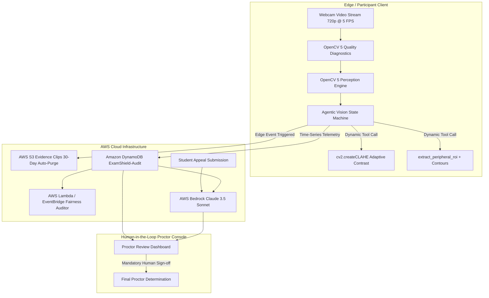
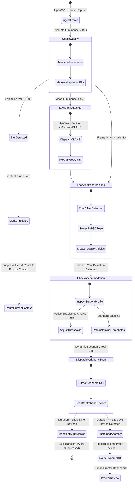
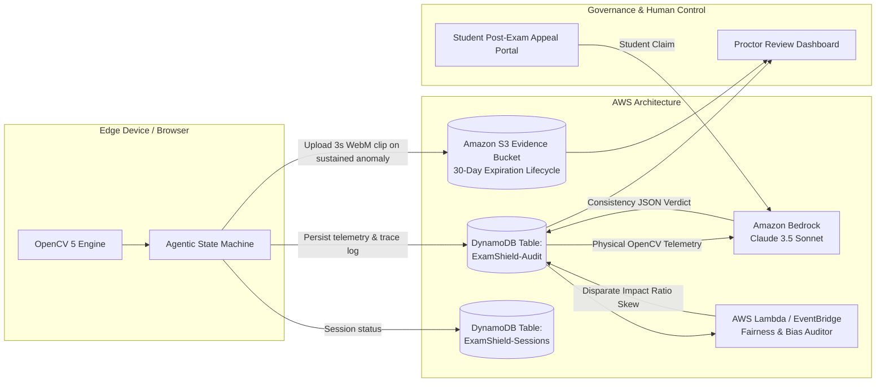

# ExamShield: Architecture & Agentic Vision Specification

ExamShield is an open, human-centered proctoring and fairness audit architecture built on **OpenCV 5** and **AWS Cloud Infrastructure**. Rather than functioning as a black-box punitive classifier, ExamShield uses an active agentic perception loop and procedural justice framework.

---

## 1. High-Level System Architecture

ExamShield bifurcates high-frequency perception (executed edge-side or local-stream using OpenCV 5) from asynchronous cloud persistence and LLM consistency auditing on AWS.

---

## 2. OpenCV 5 Perception Architecture & Module Catalog

Every computer vision primitive in ExamShield runs natively through OpenCV 5 (`opencv-python==5.0.0.93`).

| Task / Feature | OpenCV 5 Module | Specific OpenCV 5 Functions / Classes | Algorithmic Purpose |
| :--- | :--- | :--- | :--- |
| **Environmental Luminance** | `cv2` | `cv2.mean()`, `cv2.cvtColor()` | Determines mean pixel intensity ($\mu$). Triggers adaptive CLAHE if $\mu < 45.0$. |
| **Optical Blur Detection** | `cv2` | `cv2.Laplacian()`, `cv2.CV_64F`, `var()` | Computes second-order spatial derivative variance ($\sigma^2$). Marks frame as UNRELIABLE if $\sigma^2 < 100.0$. |
| **Adaptive Contrast Tool** | `cv2` | `cv2.createCLAHE()`, `cv2.split()`, `cv2.merge()`, `cv2.COLOR_BGR2LAB` | Dynamically equalizes L-channel in LAB space when low-light is diagnosed. |
| **Face & 5-Point Landmarks** | `cv2.dnn` | `cv2.FaceDetectorYN_create()`, `FaceDetectorYN.detect()` | Native OpenCV 5 YuNet deep neural network extracting bounding box and 5 facial points. |
| **Head Pose 3D Estimation** | `cv2.calib3d` | `cv2.solvePnP()`, `cv2.Rodrigues()`, `cv2.RQDecomp3x3()` | Solves Perspective-n-Point against canonical 3D facial model to derive 3D Euler angles (Yaw, Pitch, Roll). |
| **Gaze / Iris Displacement** | `cv2` | `cv2.minMaxLoc()`, `cv2.resize()` | Localizes pupil minimum intensity coordinate relative to eye canthi bounding boundaries. |
| **Lip Motion Velocity** | `cv2` | `cv2.absdiff()`, `cv2.threshold()`, `cv2.mean()` | Computes inter-frame temporal subtraction energy around mouth region to detect vocalization/speaking. |
| **Contraband / Phone Scan** | `cv2` | `cv2.Canny()`, `cv2.findContours()`, `cv2.boundingRect()`, `cv2.contourArea()` | Secondary tool triggered on gaze deviation to inspect peripheral ROI for device aspect ratios (~2:1). |

---

## 3. Agentic Perception-Decision-Action Loop

Unlike traditional static proctoring pipelines that blindly pass video through a fixed chain of detectors, ExamShield is **strictly agentic**: perception findings actively branch the execution graph, dynamically dispatch specialized computer vision tools, and adjust operational thresholds.

---

## 4. AWS Cloud Infrastructure Architecture

---

## 5. Cloud-Optimized Vision with COOL (AWS Graviton)

ExamShield provides native architectural support for **COOL** (Cloud-Optimized OpenCV Library) running on AWS Graviton instances:
- **Instance Families**: AWS Graviton3 / Graviton4 (e.g., `c7g.xlarge` / `c8g.xlarge`).
- **Acceleration**: Leverages Arm Neoverse V1/V2 cores with Neon vector extensions for OpenCV SIMD optimizations.
- **Coexistence Architecture**: Local or client-side frames run standard OpenCV 5; high-throughput batch re-examinations or institutional centralized deployments execute on Graviton instances running COOL.
- **Cost Reduction**: Achieves ~20% lower instance cost and up to 40% higher price-performance over comparable x86 compute.
